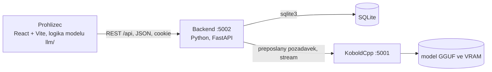
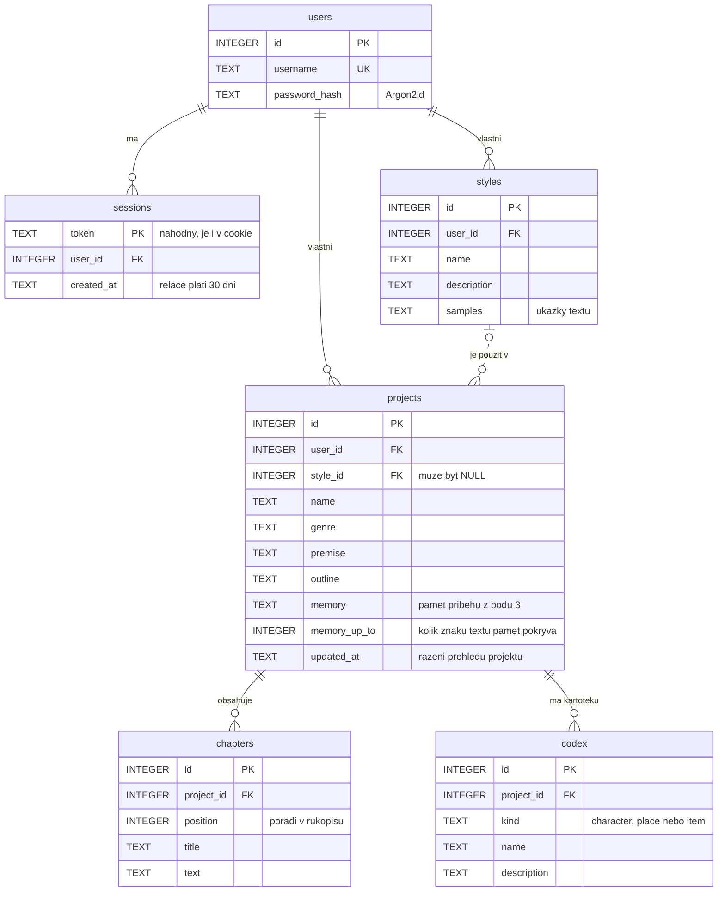

# Navrh architektury, REST API a datoveho modelu

## Architektura

| Cast | Technologie | Co dela |
|---|---|---|
| frontend | React + Vite | editor, projekty, kartoteka, ucet; bezi v nem i logika modelu z bodu 3 (`llm/`) |
| backend | Python, FastAPI | REST API, ucty a prihlaseni, jako jediny pracuje s databazi; pres `/api/llm` preposila pozadavky na KoboldCpp |
| databaze | SQLite | jeden soubor, pristup pres `sqlite3` bez ORM |
| LLM server | KoboldCpp | drzi model ve VRAM a generuje text (dok. 01) |

Vse bezi lokalne na `127.0.0.1`, backend servuje i sestaveny frontend, takze prohlizeci staci jedna adresa. Logika modelu (bod 3) bezi ve frontendu: text se streamuje rovnou do editoru a backend zustava tenky – ucty, data a brana, ktera pusti jen prihlaseneho a jen tri cesty, ktere logika pouziva. Nevyhoda: generuje se jen s otevrenou zalozkou.

Pokracovani pribehu: frontend si pres REST API nacte projekt a kapitoly → `llm/story.js` slozi prompt a posle ho na `/api/llm` → backend overi prihlaseni a streamuje odpoved z KoboldCpp → frontend novy text a pamet ulozi pres `PUT`.

Hesla Argon2id [1], prihlaseni = nahodny token v cookie `HttpOnly`, `SameSite=Strict` [2] a v tabulce `sessions` (bez `Secure`, vse bezi po HTTP jen na `127.0.0.1`).

## Datovy model

Rukopis = kapitoly za sebou podle `position`; pro model se jejich texty spoji do jednoho (mezi nimi prazdny radek, bez nazvu) a novy text se pripise do posledni kapitoly. Pamet patri projektu; kdyz se zmeni text pred `memory_up_to`, frontend ji vynuluje a spocita znovu. Styl (popis + ukazky) a kartoteka (postavy, mista, predmety) se budou vkladat do promptu. Smazani uzivatele nebo projektu smaze i jeho data (`ON DELETE CASCADE`), smazani stylu jen vynuluje `projects.style_id` (`ON DELETE SET NULL`). SQLite cizi klice hlida jen s `PRAGMA foreign_keys = ON`, backend ho proto zapne na kazdem spojeni [3].

## REST API

JSON, pole jako sloupce v diagramu (bez `password_hash`). Bez prihlaseni `401`, cizi nebo neexistujici zaznam `404`, spatny vstup `422`, chyba = `{"detail": ...}` (vychozi tvar FastAPI [4]: text, u `422` seznam chyb).

| Metoda a cesta | Co dela | Odpoved |
|---|---|---|
| POST `/api/auth/register` | zalozi ucet `{username, password}` a prihlasi | `201` + cookie, `409` jmeno je obsazene |
| POST `/api/auth/login` | overi heslo a zalozi relaci | `200` + cookie, `401` spatne jmeno nebo heslo |
| POST `/api/auth/logout` | smaze relaci | `204` |
| GET `/api/auth/me` | kdo je prihlaseny | `{id, username}` |
| PUT `/api/auth/me` | zmeni heslo `{password, new_password}` | `204` |
| DELETE `/api/auth/me` | smaze ucet i s daty | `204` |
| GET `/api/projects`, `/api/styles`, `/api/projects/{id}/chapters`, `/api/projects/{id}/codex` | seznam vlastnich zaznamu | pole zaznamu |
| POST na stejne cesty | zalozi zaznam | `201` + zaznam |
| GET, PUT, DELETE `/api/projects/{id}`, `/api/styles/{id}`, `/api/chapters/{id}`, `/api/codex/{id}` | nacte, nahradi (posila se cely zaznam), smaze | zaznam, po smazani `204` |
| POST `/api/llm/v1/chat/completions`, POST `/api/llm/api/extra/tokencount`, GET `/api/llm/api/extra/true_max_context_length` | preposle na KoboldCpp, jine cesty `404` | odpoved KoboldCpp, chat jako stream |

Priklad: `PUT /api/chapters/7` s telem `{"position": 2, "title": "Boure", "text": "…"}` vrati `200` a `{"id": 7, "project_id": 3, "position": 2, "title": "Boure", "text": "…"}`.

## Zdroje

1. OWASP. *Password Storage Cheat Sheet*. Online. [b. r.]. Dostupne z: https://cheatsheetseries.owasp.org/cheatsheets/Password_Storage_Cheat_Sheet.html. [cit. 2026-11-26].
2. OWASP. *Session Management Cheat Sheet*. Online. [b. r.]. Dostupne z: https://cheatsheetseries.owasp.org/cheatsheets/Session_Management_Cheat_Sheet.html. [cit. 2026-11-26].
3. SQLITE. *SQLite Foreign Key Support*. Online. 2026. Dostupne z: https://www.sqlite.org/foreignkeys.html. [cit. 2026-11-26].
4. FASTAPI. *Handling Errors*. Online. [b. r.]. Dostupne z: https://fastapi.tiangolo.com/tutorial/handling-errors/. [cit. 2026-11-26].
