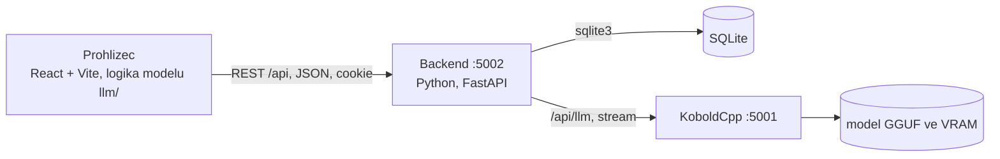
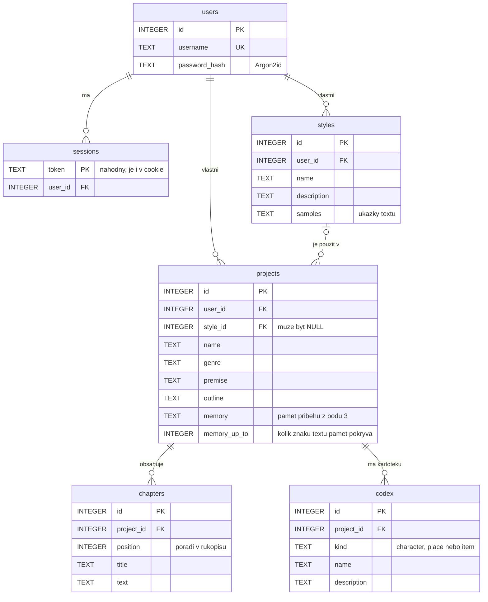

# Navrh architektury, REST API a datoveho modelu

## Architektura

| Cast | Technologie | Co dela |
|---|---|---|
| frontend | React + Vite | editor, projekty, kartoteka, ucet; bezi v nem i logika modelu z bodu 3 (`llm/`) |
| backend | Python, FastAPI | REST API, ucty a prihlaseni, jako jediny pracuje s databazi; pres `/api/llm` preposila pozadavky na KoboldCpp |
| databaze | SQLite | jeden soubor, pristup pres `sqlite3` bez ORM |
| LLM server | KoboldCpp | drzi model ve VRAM a generuje text (dok. 01) |

Vse bezi lokalne na `127.0.0.1`, backend servuje i sestaveny frontend, takze prohlizeci staci jedna adresa. Logika modelu je v JS uz z bodu 3, proto zustava ve frontendu a backend k modelu jen preposila.

Pokracovani pribehu: frontend si pres REST API nacte projekt a kapitoly → `llm/story.js` slozi prompt a posle ho na `/api/llm` → backend overi prihlaseni a streamuje odpoved z KoboldCpp → frontend novy text a pamet ulozi pres `PUT`.

Hesla Argon2id, prihlaseni = nahodny token v cookie `HttpOnly`, `SameSite=Strict` a v tabulce `sessions`.

## Datovy model

Rukopis = kapitoly za sebou podle `position`, pamet patri projektu. Smazani uzivatele nebo projektu smaze i jeho data (`ON DELETE CASCADE`), smazani stylu jen vynuluje `projects.style_id`.

## REST API

JSON, bez prihlaseni `401`, cizi data `404`.

| Cesta | Metody |
|---|---|
| `/api/auth/register`, `/login`, `/logout` | POST |
| `/api/auth/me` | GET |
| `/api/projects`, `/api/styles`, `/api/projects/{id}/chapters`, `/api/projects/{id}/codex` | GET, POST |
| `/api/projects/{id}`, `/api/styles/{id}`, `/api/chapters/{id}`, `/api/codex/{id}` | GET, PUT, DELETE |
| `/api/llm/…` | brana na KoboldCpp |
