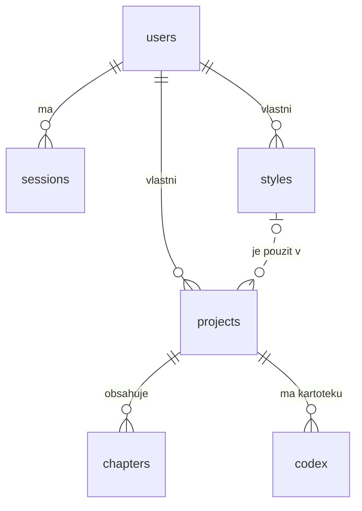

# Navrh architektury, REST API a datoveho modelu

Vse bezi lokalne na `127.0.0.1`: frontend React + Vite (je v nem i logika modelu z bodu 3) → backend FastAPI → SQLite pres `sqlite3` bez ORM. Na KoboldCpp jde frontend pres branu backendu `/api/llm`. Hesla Argon2id, prihlaseni = nahodny token v cookie `HttpOnly`, `SameSite=Strict` a v tabulce `sessions`. Rukopis = kapitoly za sebou, pamet patri projektu.

Sloupce krome `id` a cizich klicu: `users` (username, password_hash), `sessions` (token), `projects` (name, genre, premise, outline, memory, memory_up_to), `chapters` (position, title, text), `styles` (name, description, samples), `codex` (kind = character/place/item, name, description).

REST API (JSON, bez prihlaseni `401`, cizi data `404`):

| Cesta | Metody |
|---|---|
| `/api/auth/register`, `/login`, `/logout` | POST |
| `/api/auth/me` | GET |
| `/api/projects`, `/api/styles`, `/api/projects/{id}/chapters`, `/api/projects/{id}/codex` | GET, POST |
| `/api/projects/{id}`, `/api/styles/{id}`, `/api/chapters/{id}`, `/api/codex/{id}` | GET, PUT, DELETE |
| `/api/llm/…` | brana na KoboldCpp |
